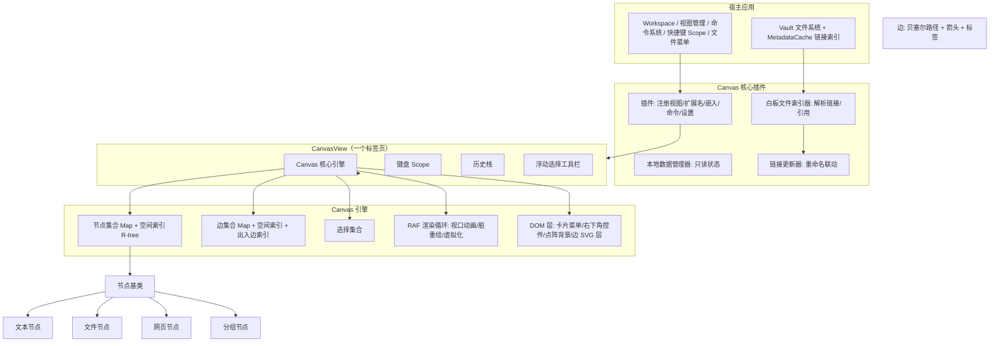

# Obsidian Canvas（白板）完整功能规格与 C++/Qt 重写指南

> 版本依据：Obsidian 桌面端内置 Canvas 核心插件（应用包 `obsidian-1.14.4.asar`，运行时 1.14.4）。
> 文件格式交叉核对：开放规范 [JSON Canvas 1.0](https://jsoncanvas.org/spec/1.0/)（2024-03-11）。
> 文档定位：面向"用现代 C++（C++17/20）与 Qt（Qt 6）从零重写一个白板程序"的**完整功能规格 + 架构映射 + 实现路线**。
>
> 法律声明：本文件是**功能与格式规格（clean-room specification）**，全部描述为行为、数据结构、数值常量与交互约定，不包含 Obsidian 任何源代码。你的实现应当独立编写。`.canvas` 文件格式为 Obsidian 公开发布的开放格式（JSON Canvas，CC0 公有领域贡献）；Obsidian 的 UI 文案、图标与主题色值属于其专有资产，重写时应自行设计。

---

## 0. 阅读指引

| 章节 | 内容 | 重写时的用途 |
|---|---|---|
| 1–2 | 产品概览、顶层架构 | 确定模块边界 |
| 3 | `.canvas` 文件格式与数据模型 | 直接实现序列化/反序列化 |
| 4–6 | 视图、节点、边的行为规格 | 实现场景元素 |
| 7–10 | 坐标、渲染、选择、交互 | 实现视口/场景/手势 |
| 11–14 | 快捷键、命令、菜单、算法 | 实现 UI 与操作 |
| 15–18 | 历史、剪贴板、联动、导出 | 工程能力 |
| 19–20 | 视觉样式、扩展 API | 皮肤/插件化 |
| 21–22 | **Qt/C++ 架构映射与实现路线** | 直接落地 |
| 23–27 | 附录：常量、示例、参考 | 速查 |

---

## 1. 产品概览

Canvas 是一个**二维无限画布（infinite canvas）**笔记工具，核心概念：

- **节点（Node / Card）**：画布上的矩形对象，共 4 种类型——
  - **文本卡片（text）**：内联 Markdown 文本，可编辑/预览；
  - **笔记（file）**：嵌入仓库中的文件（Markdown、图片、音频、视频、PDF、其它白板等）；
  - **网页（link）**：内嵌 URL 的浏览器视图；
  - **分组（group）**：半透明矩形容器，可带标签与背景图，用于在视觉上圈住其它节点。
- **边（Edge / Connection）**：连接两个节点的三次贝塞尔曲线，可有箭头（单向/双向/无向）、颜色与文字标签。
- **画布（Canvas）**：无限平移/缩放的二维世界坐标；点网格背景；内容随缩放自动挂载/卸载（虚拟化）。
- 每个白板是一个 `.canvas` 文件（JSON 文本），视图视口状态（平移与缩放）保存在宿主布局里，**不写入文件**；只读状态保存在每个视图的本地数据里，也不写入文件。

**视图注册信息**：
- 视图类型 id：`canvas`；文件扩展名：`canvas`；视图图标：`layout-dashboard`（菱形仪表盘）。
- 新建文件默认名：`Untitled.canvas`（新建后立即进入重命名态），创建位置由设置决定（仓库根 / 当前文件夹 / 指定文件夹）。
- 当 `.canvas` 被嵌入到 Markdown 笔记中时，渲染为一个**静态 SVG 缩略图**（只读小地图）。

---

## 2. 顶层架构

Obsidian 内部 Canvas 划分为以下职责单元（括号内为混淆类名，仅用于与本文件分析过程对应，**你的实现中不要沿用**）：



**关键职责说明**：

1. **插件层**：注册视图类型、扩展名、嵌入式渲染器、全局命令、设置页、文件管理器钩子；监听文件重命名/删除并批量更新所有白板；维护白板内容的链接索引（用于反向链接、搜索）。
2. **视图层（CanvasView）**：负责文件读写（把 JSON 交给引擎）、标签页生命周期、键盘作用域、视口状态存取、窗格菜单（导出 PNG）、只读本地数据。
3. **引擎层（Canvas）**：纯逻辑 + 渲染。维护节点/边集合与空间索引、选择集、当前视口（x,y,zoom）、动画、单帧渲染循环、撤销历史、剪贴板、拖拽与手势、命中测试、对齐/分布/排列、吸附、导出。
4. **节点**：HTML 元素（绝对定位 + CSS transform），文件节点内部挂载宿主的标准"嵌入组件"（Markdown 编辑器、图片、音视频、PDF、iframe、白板缩略图）。
5. **边**：SVG 元素（路径 + 箭头多边形 + HTML 标签胶囊）。

> Qt 映射建议见第 21 章。简而言之：**CanvasView → QWidget 视图；Canvas → QGraphicsScene；节点 → QGraphicsItem（含 QGraphicsProxyWidget）；边 → QGraphicsPathItem；历史 → QUndoStack；文件 → QJsonDocument**。

---

## 3. 文件格式与数据模型

### 3.1 顶层结构

`.canvas` 是 UTF-8 JSON 文本。顶层对象：

```json
{
  "nodes": [ /* 节点数组，按 z-index 升序排列 */ ],
  "edges": [ /* 边数组 */ ]
}
```

| 字段 | 类型 | 必填 | 说明 |
|---|---|---|---|
| `nodes` | Node[] | 否（开放规范） | 节点数组；Obsidian 写入时总是存在。元素按绘制顺序（z 序）升序，第一个在最底，最后一个在最顶。 |
| `edges` | Edge[] | 否（开放规范） | 边数组；Obsidian 写入时总是存在。 |

- 顶层**不保存**视口位置、缩放、只读状态、折叠状态（这些存于宿主布局/本地数据/各文件自身状态）。
- 未知顶层字段：Obsidian 会保留（每个节点/边还会保留其**未知属性**到内部 `unknownData`，再次序列化时原样写回，实现前向兼容）。**重写时务必保留未知字段**。
- 空文件 / 空对象：显示空白占位提示。

### 3.2 通用节点字段

| 字段 | 类型 | 必填 | 默认 | 说明 |
|---|---|---|---|---|
| `id` | string | 是 | — | 全局唯一 ID，Obsidian 生成 **16 个随机十六进制字符（小写 0-9a-f）**。 |
| `type` | string | 是 | — | `text` / `file` / `link` / `group`。未知类型忽略。 |
| `x` | integer | 是 | 0 | 世界坐标 X（px）。读取时四舍五入为整数。 |
| `y` | integer | 是 | 0 | 世界坐标 Y（px）。读取时四舍五入为整数。 |
| `width` | integer | 是 | 100（运行时缺省） | 宽度 px，整数；最小 50。 |
| `height` | integer | 是 | 100（运行时缺省） | 高度 px，整数；最小 50。 |
| `color` | string | 否 | `""`（无色） | 颜色，见 3.6。 |

### 3.3 各类型节点专有字段

**文本节点 text**

| 字段 | 类型 | 必填 | 说明 |
|---|---|---|---|
| `text` | string | 是 | 纯文本，支持 Markdown 语法。空串显示"左对齐"图标占位。 |

**文件节点 file**

| 字段 | 类型 | 必填 | 说明 |
|---|---|---|---|
| `file` | string | 是 | 相对仓库根的文件路径（正斜杠 `/`）。文件不存在时显示"空嵌入"错误态（新建笔记 / 替换文件 / 移除）。 |
| `subpath` | string | 否 | 子位置，**总是以 `#` 开头**：`#标题名`（heading）或 `#^块ID`（block）；PDF 为 `#page=N`；Bases（数据库）为 `#视图名`。 |

**网页节点 link**

| 字段 | 类型 | 必填 | 说明 |
|---|---|---|---|
| `url` | string | 是 | `http://` 或 `https://`（其它协议按规则处理）；若 URL 匹配视频站点（YouTube/Vimeo 等），新建时默认尺寸 640×360（16:9）。 |

**分组节点 group**

| 字段 | 类型 | 必填 | 默认 | 说明 |
|---|---|---|---|---|
| `label` | string | 否 | `""` | 分组顶部标签，可直接内联编辑（contenteditable，Enter 提交、Esc/失焦结束）；新建时默认文本"Untitled group"。 |
| `background` | string | 否 | — | 背景图片的仓库相对路径。 |
| `backgroundStyle` | string | 否 | `cover` | 背景渲染方式：`cover`（填满裁剪）/ `ratio`（保持图片宽高比，约束节点尺寸）/ `repeat`（按原图平铺，左上角对齐）。当值为 `cover` 时 Obsidian **不写出**该字段（省略即默认）。 |

### 3.4 边字段

| 字段 | 类型 | 必填 | 默认 | 说明 |
|---|---|---|---|---|
| `id` | string | 是 | — | 16 位十六进制。 |
| `fromNode` | string | 是 | — | 起点节点 id。 |
| `fromSide` | string | 否 | 自动 | 起点附着边：`top` / `right` / `bottom` / `left`；缺省时按两节点几何关系自动计算。 |
| `fromEnd` | string | 否 | `none` | 起点端形状：`none` / `arrow`。 |
| `toNode` | string | 是 | — | 终点节点 id。 |
| `toSide` | string | 否 | 自动 | 终点附着边；缺省自动计算。 |
| `toEnd` | string | 否 | `arrow` | 终点端形状：`none` / `arrow`。 |
| `color` | string | 否 | `""` | 颜色。 |
| `label` | string | 否 | `""` | 边中央的文字标签（可编辑）；空串时序列化省略。 |

- 序列化时：`fromEnd === "none"` 不写出；`toEnd === "arrow"` 不写出；`color`/`label` 为空不写出。
- 端点缺失（引用的节点不存在）时，该边不会被实例化（安全跳过）。
- UI 上的"连线方向"三态与两端字段的组合：

| UI 方向 | fromEnd | toEnd |
|---|---|---|
| 无向（Non-directional） | `none` | `none` |
| 单向（Unidirectional） | `none` | `arrow` |
| 双向（Bidirectional） | `arrow` | `arrow` |

### 3.5 节点几何默认值与常量

| 常量 | 值 | 说明 |
|---|---|---|
| `zoomMultiplier` | 0.5 | 点击 +/− 按钮或单次滚轮的缩放系数（zoom 指数增量）。 |
| `objectSnapDistance` | 15（屏幕 px） | 对象吸附的屏幕距离阈值（世界坐标中除以当前缩放）。 |
| `minContainerDimension` | 50 | 节点最小宽/高（px）。 |
| 新建文本节点尺寸 | 250 × 60 | 双击空白/卡片菜单创建。 |
| 新建文件/网页节点尺寸 | 400 × 400 | 拖文件/选文件/输入 URL 时（视频 URL 为 640×360）。 |
| 批量添加文件节点间距 | 尺寸 + 45 | 每行 10 个网格排布：`x = startX + (w+45)*(i%10)`，`y = startY + (h+45)*floor(i/10)`。 |
| 运行时裸节点缺省 | 100 × 100 | 仅当数据无尺寸时的内部缺省。 |
| 历史栈容量 | 100 步 | 超出丢弃最旧。 |
| 节点/边 ID | 16 个随机 hex | 新建块引用 ID 为 6 个 hex。 |
| 剪贴板 MIME | `obsidian/canvas` | 内容为 `{nodes, edges, center}` JSON。 |

### 3.6 颜色模型

`color` 是字符串，三种形态：

1. **预设色号**：`"1"`~`"6"`（正则 `^\d+$`），映射到主题色（类名 `mod-canvas-color-1..6`）：
   - `1` 红、`2` 橙、`3` 黄、`4` 绿、`5` 青（cyan）、`6` 紫（purple）。
   - 具体色值不写死，跟随主题变量（Obsidian 用 `--color-red/orange/yellow/green/cyan/purple`）。
2. **自定义 hex**：如 `"#ff0000"`，由颜色选择器写入。
3. **兼容三元组**：`"r,g,b"`（如 `"255,0,0"`），解析为 `rgb()`。
4. 空字符串 `""` 表示无颜色（默认边框/文字色）。

节点着色范围：边框/标题栏/头部；边着色范围：线条、箭头与标签；分组着色范围：描边与标签。自定义颜色还会根据亮度自动决定前景文字是深色还是浅色。

### 3.7 最小合法示例

```json
{
  "nodes": [
    { "id": "a1b2c3d4e5f60718", "type": "text",
      "x": -125, "y": -30, "width": 250, "height": 60,
      "text": "# Hello Canvas\n\n这是一张卡片" },
    { "id": "1111222233334444", "type": "group",
      "x": -200, "y": -120, "width": 700, "height": 360,
      "label": "主题分组", "color": "4" },
    { "id": "5555666677778888", "type": "file",
      "x": 200, "y": -20, "width": 400, "height": 400,
      "file": "notes/idea.md", "subpath": "#第二节" },
    { "id": "9999aaaabbbbcccc", "type": "link",
      "x": 200, "y": 420, "width": 640, "height": 360,
      "url": "https://example.com" }
  ],
  "edges": [
    { "id": "dddddeeeeffff0000",
      "fromNode": "a1b2c3d4e5f60718", "fromSide": "right",
      "toNode": "5555666677778888", "toSide": "left",
      "label": "引出" }
  ]
}
```

### 3.8 与 JSON Canvas 1.0 开放规范的对照

- 1.0 规范中 `nodes`/`edges` 均为可选；Obsidian 读时容忍缺失（`nodes` 不是数组则整体拒绝解析），写时总是输出两个数组。
- 规范只定义了上述字段；Obsidian 严格按规范输出，**没有额外私有字段**（`backgroundStyle` 为规范字段）。
- 规范要求节点按 z-index 升序排列；Obsidian 序列化前按内部 zIndex 排序。
- 你的实现若想与 Obsidian 互通：读时宽容（未知字段/类型忽略但保留未知键），写时只输出规范字段并省略默认值。

---

## 4. 视图与生命周期

### 4.1 打开/关闭

- 打开白板：读取文件文本 → `JSON.parse` → 全量构建引擎（缺失端点的边丢弃；`fromSide/toSide` 缺失时自动计算）→ 若为首次打开则排队一次"缩放适应全部"（zoomToFit）。
- 关闭：卸载画布（移除节点/边、清空历史、注销 window 键盘监听）。
- 保存：引擎数据变更后标记 dirty，由视图防抖写入文件（JSON.stringify）。
- 布局状态：`getState()` 返回 `{x, y, zoom}`（当前视口中心点与缩放指数），存入工作区布局；`setState()` 恢复。
- 临时状态（ephemeral）：`{focus: true}` 聚焦画布；`{match:{nodeId, content, matches}}` 从全局搜索定位到卡片内文字（选中节点、滚动到可视区、高亮匹配项）。

### 4.2 只读（Read-only）

- 切换入口：右下角齿轮按钮 / 画布右键菜单。开启后齿轮变锁图标，wrapper 加 `mod-readonly` 类，**禁止一切写操作**（不能选/建/改/删/连线/拖放；浮动工具栏与菜单只读）。
- 状态存于该视图的**本地数据**（localData，键随文件走），不写入 `.canvas`；文件删除/重命名时联动迁移。

### 4.3 Canvas 设置项（全部在插件设置页）

| 设置 | 键 | 类型/取值 | 默认 | 说明 |
|---|---|---|---|---|
| 新建白板位置 | `newFileLocation` | `root` / `current` / `folder` | `root` | 仓库根 / 当前文件夹 / 指定文件夹。 |
| 指定文件夹路径 | `newFileFolderPath` | string | — | 仅 `folder` 时显示。 |
| 滚轮行为 | `defaultWheelBehavior` | `pan` / `zoom` | `pan` | `pan`：滚轮平移、Mod+滚轮缩放；`zoom`：互换。 |
| Mod+拖拽行为 | `defaultModDragBehavior` | `menu` / `card` / `note` / `media` / `webpage` / `group` | `menu` | 在空白处按住 Mod 拖出选框后松手：弹创建菜单，或直接创建指定类型。 |
| 卡片名称显示 | `cardLabelVisibility` | `always` / `hover` / `never` | `always` | 文件/网页节点顶部文件名标签；hover 时标签带 `mod-hover-label`。 |
| 网格吸附 | `snapToGrid` | 开关 | **开** | 移动/缩放时对齐背景点阵。 |
| 对象吸附 | `snapToObjects` | 开关 | **开** | 移动/缩放时与附近对象边/中线吸附。 |
| 隐藏内容的缩放阈值 | `zoomBreakpoint` | 滑块 −0.7~2.4，步长 0.01 | 0 | 阈值 zoom = **−1.7 − 设置值**（默认 −1.7）；低于该缩放，卡片内容卸载（性能），仅保留外框。设置页以 `100*1.2^值%` 显示百分比。 |

> 导出 PNG 的设置在导出对话框内（见第 18 章），不存为全局设置。

---

## 5. 节点详细规格

### 5.1 通用节点行为

- 每个节点是一个绝对定位的矩形（世界坐标），渲染时整体随画布 transform 缩放；通过 `transform: translate(x,y)` 定位，宽高为节点宽高。
- **选择/焦点**：单击选中（Shift 切换）；多选时选中元素加 `is-selected`；唯一选中项为"焦点"（`is-focused`，z 序提升到最顶）。
- **z 序**：普通节点由引擎按选中/交互顺序分配递增 zIndex；**分组节点固定按面积取负序**：`zIndex = -round(width*height)`（面积越大越靠底，保证大分组不会盖住小内容）。
- **8 个缩放手柄**：上/右/下/左 + 4 角；右/下边（角）双击触发"内容自适应"（仅文件/文本的 Markdown 嵌入实现）。
- **4 个连接点**：每边中点，悬停时显示，按下拖出连线（见 6.5）。
- **缩放（resize）规则**：
  - 最小 50px，缩放钳制；对边固定（拖左边时右边不动）。
  - 支持网格/对象吸附；4 角手柄在节点有固定宽高比（图片/视频/ratio 背景）时锁比例，单边手柄按比例推导另一维。
  - 松手入历史栈，Esc 取消。
- **双击手柄自适应**（Markdown 嵌入）：
  - 拖上/下手柄后双击：迭代（≤10 次）把高度调到恰好包住内容（`scrollHeight` 差值，每次 +1px）。
  - 拖左/右手柄后双击：二分搜索（≤10 次）最小宽度，使内容不出现纵向滚动。
- **内容断点**：当 `zoom <= zoomBreakpoint` 且节点不在编辑态时，文件/网页节点卸载重内容（Markdown/iframe/媒体），仅保留外框与占位（白板缩略图等轻量内容保留）；放大或进入编辑时重新挂载。
- **阴影/选中框、高亮描边**等通过 CSS 类切换。

### 5.2 文本节点（text）

- 内部是一个**完整的嵌入式 Markdown 编辑器组件**（与笔记编辑同源），放在 iframe 沙箱中：
  - 支持源码/实时预览/阅读三种模式（继承宿主编辑器能力）、Markdown 全部语法、内嵌图片/链接/代码块/公式、任务列表折叠等；
  - 卡片有自己的滚动条，内容超出可滚动；折叠状态按"白板路径 + `#^` + 节点ID"保存。
- 可被作为**块引用**目标：链接形如 `my.canvas#^<节点id>`。
- **双击进入编辑**（只读时禁止）；新建文本卡片自动进入编辑态。
- 菜单：编辑、**转换为文件（Convert to file）**：弹窗输入文件名（默认 "Untitled"）→ 在指定位置创建 `.md`（内容为卡片文本）→ 原位替换为文件节点，**把原卡片的入/出边全部重连到新文件节点**。
- 空内容时显示"左对齐"图标的空占位。

### 5.3 文件节点（file）

- 通过宿主的**嵌入注册表（embed registry）**按扩展名加载对应嵌入组件：

| 内容 | 行为 |
|---|---|
| `.md` Markdown | 内嵌完整 Markdown 编辑器（可编辑，iframe 沙箱，折叠状态本地化），菜单含"在新标签页打开"与"编辑"。 |
| `.canvas` 白板 | 静态 SVG 缩略图（见 18.3 同构渲染器），点击打开。 |
| 图片 | ``，不可拖动；加载后按图片宽高比把节点调整为"以当前宽为基准的等比高度"。 |
| 视频 | `<video>`，按视频宽高比调整节点。 |
| 音频 | `<audio>`，节点高度自动收缩为约 42px。 |
| PDF | PDF 查看器；工具栏多一个"保存 PDF 位置"按钮，把当前页码以 `subpath: "#page=N"` 持久化。 |
| 其它 | 宿主注册的其它嵌入类型（如下载/通用附件）。 |

- **节点标签**：顶部显示文件名（`cardLabelVisibility` 控制显隐）；当有 `subpath` 且为 Markdown 时，显示 `文件名 › 标题/块`。
  - 单击标签：Mod 按下时在新标签打开，否则普通跟随；
  - 双击标签：在新标签打开该定位。
- **Narrow to heading...（定位到标题）**：弹出标题建议（读元数据缓存 headings），写入 `subpath=#标题`。
- **Narrow to block...（定位到块）**：弹出块建议；若选中的块没有 ID，自动生成 6 位 hex 块 ID（`^xxxxxx`）并写回源文件。
- **Pin view...（固定视图，Bases 数据库文件）**：选择某个视图名，写入 `#视图名`。
- **Swap file（替换文件）**：文件选择器（Markdown 节点可显示 md/canvas），更换文件并清空 subpath。
- **Rename（重命名）**：无 subpath 时菜单里提供，调用宿主重命名（会触发全局联动）。
- 当 `file` 指向不存在的文件：显示"空嵌入"占位（可新建同名笔记、替换文件、删除卡片）。
- 文件被聚焦时会更新宿主的"当前打开文件"（用于面包屑/链接跟随）。

### 5.4 网页节点（link）

- 桌面端用 `<iframe>`/webview 加载 URL；YouTube 等特殊嵌入地址走自定义 UA（`releases.obsidian.md/youtube` 嵌入页）。
- 菜单：**Change URL（修改 URL，校验合法 URL）**、**在浏览器打开**、**复制 URL**、**Reload page（重新加载）**。
- 标签即 URL；视频类 URL 初始 640×360。
- 拖入纯 URL 文本自动创建网页节点。

### 5.5 分组节点（group）

- 视觉上是带圆角、描边、浅色填充的容器；标签为顶部可编辑文本（双击或菜单 Edit label，Enter 提交，空标签隐藏）。
- 节点 z 序恒为负面积序（见 5.1）。
- **背景图**：
  - 设置：选择仓库内图片；替换 / 移除；
  - `cover`（默认）：居中裁剪填满（`background-size: cover`）；
  - `ratio`：加载图片得到宽高比，节点被约束为该比例（`resize` 时夹到等比矩形，`overrideHistory` 合并历史）；
  - `repeat`：原图尺寸、左上对齐、双向平铺。
- 框选时**只有被完全包含的分组才被选中**（普通节点相交即可）。
- 拖动分组时，**自动带上完全位于其内部的节点一起移动**；对一组节点"Create group"时，以其整体外包框 +20px 内边距创建分组。
- 对齐/分布操作作用于分组时，目标对象是其**包含的子节点**（操作框取分组 bbox ±20px）。
- 连线不能在"包含关系"的两个分组之间建立（拖连时过滤）。

---

## 6. 边详细规格

### 6.1 数据与附着

- 边是两个节点端点（`{node, side, end}`）的连接；side 可持久化，也可缺省。
- **自动选边**：当 side 缺失时，用两节点中心向量夹角 `atan2(dy,dx)` 与节点自身张角 `atan2(height,width)` 比较，确定连接点落在 right/bottom/left/top 哪一边（即"从自己几何中心看对方在哪个方向"）。
- 每个端点的连接点 = 该边中点（`Wee`）：上=中上边点、右=中右边点、下=中下边点、左=中左边点。

### 6.2 路径几何

- 曲线为**三次贝塞尔**，端点为连接点（无箭头时端点再沿法线外推 7px，使视觉与卡片边框贴合）。
- 两个控制点沿各自 side 的法线方向偏移：
  - 偏移量 `d = clamp(两端点距离 / 2, 70, 150)`（世界 px）；
  - 上/下边控制点沿 ±Y 偏移，左/右边沿 ±X 偏移。
- 边外包框 = 两端连接点的最小外包矩形（用于空间索引、命中、Follow connection）。
- 路径在 SVG 中绘制两份：
  - **display path**：可见线，宽 `2px * zoomMultiplier`（屏幕像素恒定，`zoomMultiplier = 1/sqrt(scale)`）；悬停/选中时 5.5px；圆角线帽。
  - **interaction path**：透明命中线，宽 `24px * zoomMultiplier`，便于点选；光标 `grab/grabbing`。

### 6.3 箭头与标签

- 箭头是 SVG 三角形，点坐标 `0,0 6.5,10.4 -6.5,10.4`（朝上），按 side 旋转：`top=180°, bottom=0°, left=90°, right=270°`；随 `zoomMultiplier` 缩放。
- 无箭头端：路径直接画到外推点；有箭头端：路径止于连接点，三角形叠在该点。
- **标签**：位于贝塞尔曲线 t=0.5 处，HTML 胶囊（圆角、主背景色），字号随 `zoomMultiplier` 恒定屏幕大小；双击/菜单进入内联编辑（contenteditable），输入即改（不立即压栈，失焦/清空时保存），空标签删除。

### 6.4 选择与菜单

- 单击：未选中则单选；已选中且无标签编辑态则直接进入标签编辑；Shift 切换多选。
- 右键菜单：删除、编辑标签、**Follow connection（沿连接跳转）**：比较光标距两端点的远近，把另一端所在节点缩放居中（zoomToBbox）；并触发 `canvas:edge-menu` 扩展事件。
- 多选边时浮动工具栏提供"连线方向"切换（无向/单向/双向，批量改 `fromEnd/toEnd`）、标签编辑/删除。

### 6.5 拖拽连线

- 从节点连接点拖出：立即创建一条临时边（起点为该节点该边，终点为鼠标处的 0×0 临时节点，默认 toEnd=arrow），画布加 `is-connecting` 类；
- 拖动过程：命中附近 15px 内的节点（排除自身、排除包含/被包含的分组），自动吸附到对应 side（边的 toSide 实时切换到目标节点的相邻边）；
- 松手：
  - 命中节点：连接成立，保存；
  - 空白处：弹"连接投放菜单"——Add card（创建并连接文本卡片）、Add note（文件选择器，可直接创建新笔记）；若源节点是文件节点，还会列出其**出链中尚未连接的文件（最多 20 个）**直接连接；并触发 `canvas:node-connection-drop-menu` 事件；
  - 菜单关闭未选：50ms 后删除临时边；Esc 取消。
- 从**已有边的端点**（箭头/连接点）拖起：等价于重连该端（同一临时节点机制）。

---

## 7. 画布坐标系与视口

### 7.1 坐标系

- 世界坐标（canvas coords）单位 px，x 向右、y 向下，原点在画布中心附近的任意无穷位置。
- 屏幕→世界：`world = (screen - viewportCenter) / 2^zoom + (x,y)`，即

```
screenPoint = scale · (worldPoint − (x,y)) + (w/2, h/2)
scale = 2^zoom
```

CSS transform（对"画布层"整体施加）：

```
translate(w/2, h/2) scale(2^zoom) translate(-x, -y)
```

其中 `(x,y)` 是当前视口中心在世界坐标中的位置，`zoom` 是缩放指数（指数缩放，保证每档手感一致）。

### 7.2 缩放模型

| 项 | 值/规则 |
|---|---|
| 缩放范围 | `zoom ∈ [-4, 1]`，即 **6.25% – 200%** |
| 按钮步进 | 每次 +/− 0.5（2 的 0.5 次方 ≈ 1.414×） |
| 滚轮 | 桌面：`deltaZoom = -deltaY / 300`（Mac 触控板 ×2）；以光标为锚点；Mod+滚轮在 pan 模式下缩放（设置可互换） |
| 触控板捏合 | 走系统 pinch 事件（wheel + ctrlKey），同样以 pinch 中心为锚 |
| Shift+滚轮 | 横向平移（`x` 轴） |
| 缩放动画 | 目标 `tZoom`，每帧 `z += (target-z)·(1 - 0.984^dt)`；`dt` 为距上一帧毫秒；残差 <0.01 时吸附 |
| 平移惯性 | 拖拽结束按速度衰减，系数 0.93/帧 |
| 适应函数 | `zoomToBbox(bbox)`：`scale = min(1.1·W/(bboxW), 1.1·H/(bboxH))`，zoom = log2(scale) 并钳制到 [-4,1]；目标中心 = bbox 中心；**留 10% 边距**；`zoomToFit` 对全部节点 bbox 调用，`zoomToSelection` 对选择集 |
| 智能缩放（Mac ctrl+滚轮） | 若光标下有选中元素→适应选中；否则适应命中节点；否则适应全部 |

### 7.3 网格背景

- 背景为 SVG 点阵（圆点 r=0.7，颜色 `--color-base-30`，随明暗主题变化）。
- 网格间距随缩放变化（视觉密度近似恒定）：

| zoom | 间距（世界 px） |
|---|---|
| < −3.3 | 160 |
| < −2.16 | 80 |
| < −0.91 | 40 |
| 其它 | 20 |

- 网格吸附步长同样取 `gridSpacing`。
- 当 zoom ≤ −1.7 时画布容器加 `mod-zoomed-out` 类（用于切换视觉密度/隐藏内容）。

### 7.4 视口状态与布局

- 视图状态 `{x, y, zoom}` 存于工作区布局；`getViewState()` 写、`setViewState()` 读。
- 所有程序化移动（zoomToFit、panTo、Follow connection、jump-to-group）都走**同一套动画目标**（`tx, ty, tZoom`），避免跳跃。

### 7.5 嵌入白板缩略图

- Markdown 里 `![[x.canvas]]` 渲染为静态 SVG：圆角矩形（rx=20）、分组/节点颜色与边（贝塞尔同构），viewBox 取全部节点 bbox 外扩 1/20 边距；不可编辑，点击打开。

---

## 8. 渲染管线

### 8.1 单帧循环（requestAnimationFrame）

- 引擎维护 `requestFrame` 标志、`moved`/`dirty` 集合；每帧：
  1. 处理视口动画（向 tx/ty/tZoom 缓动）；
  2. 若有移动/变更：重建受影响节点/边的空间索引（节点 bbox 缓存）；
  3. 重新计算视口节点 bbox（当前可见范围 + 100px 缓冲）；
  4. **虚拟化挂载**：新进入视口的节点挂载 DOM（每帧最多 10 个），离开视口的卸载；边在视口内即挂载；
  5. 重定位节点（transform）、重绘边路径/标签、更新点阵背景与吸附线。
- 节点 z 序按 zIndex 重排 DOM；选中元素置顶。

### 8.2 空间索引

- 两个二维 R-tree（rbush 风格，节点存缓存 bbox）：
  - 节点索引：`insert/remove/search(bbox)`，比较键为 `x, y`（节点 bbox 随几何变化更新）；
  - 边索引：键为边外包框。
- 另有多重映射 `edgeFrom`/`edgeTo`：nodeId → 关联边集合（快速取节点邻接边、删除节点时同步删边）。
- 典型查询：`getViewportNodes()`（视口候选，可加 100px 缓冲）、`getIntersectingNodes(bbox)`、`getContainingNodes(bbox)`（框选/分组包含）、`getEdgesForNode(node)`。

### 8.3 DOM 层级（Qt 对应 Item Z）

```
.canvas-wrapper（方向 ltr，mod-readonly / is-connecting / mod-zoomed-out / is-screenshotting）
├─ .canvas-background（SVG 点阵 pattern）
├─ .canvas-horiz-selection（选中框选矩形）
├─ .canvas-edges（SVG 层，每边 <g>: interaction path + display path + 箭头 polygon）
├─ .canvas（变换层：所有节点 .canvas-node）
│   └─ 节点：外框/标签/内容嵌入/8 手柄 + 4 连接点
├─ .canvas-path-label（边标签 HTML 层）
├─ .canvas-selection-menu（浮动选择工具栏）
├─ .canvas-card-menu（左下卡片快捷菜单）
├─ .canvas-controls（右下角控件组）
└─ 提示文字（空画布/拖拽提示）
```

### 8.4 性能要点

- 重内容（iframe、编辑器、PDF、视频）随视口挂载/卸载；缩放小于断点时卸载内容。
- 屏幕恒定粗细：线宽/字号/箭头/手柄均乘 `zoomMultiplier = 1/√scale`。
- 长文本节点（>5000 字符）的 Markdown 链接解析为异步（不阻塞索引）。

---

## 9. 选择系统

| 操作 | 行为 |
|---|---|
| 单击节点 | 取消其它选择并选中该节点（设为焦点）；有 Mod 修饰则按多窗格规则 |
| 单击边 | 选中边；若边已选中且无标签编辑则直接进入标签编辑 |
| Shift+单击 | 切换该元素在选择集中的存在 |
| 空白按下拖出框 | 选框（marquee）：矩形与节点 bbox **相交即选**；**分组只有完全包含才选**；边端点节点都在选框内才选 |
| Shift+框选 | 对选中结果做"对称差"切换 |
| Mod+框选 | 按 `defaultModDragBehavior`：弹创建菜单 / 直接创建卡片/笔记/媒体/网页/分组 |
| Esc | 取消全部选择 |
| 全选 | Mod+A：选中所有节点与边 |
| 视觉 | `is-selected` 高亮；唯一焦点 `is-focused`；置顶 zIndex |

---

## 10. 交互与手势

### 10.1 平移与缩放（桌面）

| 操作 | 行为 |
|---|---|
| 空格 + 拖拽 | 抓手平移（可在选择态之外） |
| 鼠标中键拖 / 右键拖 | 平移（Mac：Ctrl+左键拖） |
| 鼠标左键拖空白 | 框选（见第 9 章）；平移用抓手 |
| 滚轮（默认 pan 模式） | 垂直平移；Shift+滚轮水平平移；**Mod+滚轮以光标为锚缩放** |
| 滚轮（zoom 模式） | 行为互换（滚轮缩放，Mod+滚轮平移） |
| 触摸板捏合 | 系统 pinch 缩放（锚点为捏合中心） |
| 智能缩放 | Mac Ctrl+滚轮：适应选中/命中节点/全部 |
| 双击空白 | 在视口中心创建 250×60 文本卡片并进入编辑 |
| 右键空白 | 画布菜单（见 12.3） |

### 10.2 节点移动与克隆

- 左键拖节点：进入 `is-dragging`，拖动整个选择集（包含分组内的子节点）；
- **Shift 拖拽**：约束为单轴（移动量大的轴）；
- **Ctrl 拖拽（Win/Linux）/ Alt 拖拽（Mac）**：拖拽期间克隆（克隆卡片会被拖出，松手时生成新 ID、粘贴为副本，源不动）；
- **Alt 拖拽（Win/Linux）/ Ctrl 拖拽（Mac）**：临时关闭吸附（`canSnap` 判定）；
- 方向键：移动 1 个网格；Shift+方向键 5 个网格；开网格吸附时按网格对齐；
- 拖拽中画布边缘自动平移（`handleDragWithPan`）。

### 10.3 触摸（移动端）

- 单指：平移（也可拖卡片）；
- 双指：捏合缩放（`deltaZoom = log2(捏合距离比)`，钳制 [-4,1]，锚点为双指中点；同时双指平移）；
- 长按 **600ms**：触发右键菜单（并振动 10ms）；
- 单击空白：取消选择；
- 创建/缩放/连线交互与桌面一致，但显示移动版提示文案。

### 10.4 拖放（DnD）

| 来源 | 落点行为 |
|---|---|
| 仓库拖入文件/链接 | 在落点创建文件节点（多个文件按尺寸+45、每行 10 个网格摆放）；文件夹递归展开、按文件名排序 |
| 系统拖入附件 | 导入为文件节点（图片等） |
| 拖入 URL | 网页节点（视频站 640×360，否则 400×400） |
| 拖入纯文本 | 文本卡片 |
| 拖入 Markdown 文件 | 文件节点（可编辑嵌入） |

### 10.5 键盘编辑

- 文本节点：双击或菜单进入编辑；编辑态下键盘事件交给编辑器，Esc 退出；
- 分组标签、边标签：contenteditable 内联编辑，Enter 提交、Esc 取消；
- 复制/粘贴见第 16 章。

---

## 11. 快捷键与命令

### 11.1 画布键盘作用域（桌面）

| 快捷键 | 动作 |
|---|---|
| 空格 + 拖 | 平移 |
| 右键/中键拖（Mac Ctrl+左键） | 平移 |
| 滚轮 / Shift+滚轮 | 垂直/水平平移 |
| Mod+滚轮（默认） | 缩放（可在设置里互换） |
| `Shift+1` | 缩放适应全部（Zoom to fit） |
| `Shift+2` | 缩放适应选中（Zoom to selection） |
| `Mod+A` | 全选 |
| `Mod+Z` | 撤销 |
| `Mod+Y` 或 `Mod+Shift+Z` | 重做 |
| `Esc` | 取消选择/取消连线/退出编辑 |
| `Backspace` / `Delete` | 删除选中（节点含其关联边；分组不删子节点） |
| 方向键 | 移动 1 网格 |
| `Shift+方向键` | 移动 5 网格 |
| Shift+点击/框选 | 多选切换 |
| Ctrl/Alt+拖（按平台） | 克隆 / 关吸附（见 10.2） |
| Shift+拖 | 锁定单轴 |
| 双击空白 | 新建文本卡片 |
| 双击边 | 编辑标签 |
| 双击手柄（右/下） | Markdown 内容自适应 |

> `Mod` = Win/Linux 为 Ctrl，macOS 为 Cmd。命令面板另有"导出为 PNG / 跳转分组 / 转换为文件 / 新建白板"等命令。

### 11.2 全局命令

| 命令 id | 名称 | 行为 |
|---|---|---|
| `canvas:new-file` | Create new canvas | 按设置位置创建 `Untitled.canvas`，打开并进入重命名 |
| `canvas:export-as-image` | Export as image | 打开导出对话框（仅当前视图为白板时可用） |
| `canvas:jump-to-group` | Jump to group | 弹出分组建议列表（无分组时提示），选中后 `zoomToBbox` |
| `canvas:convert-to-file` | Convert to file | 仅当选择集恰好为一个文本节点时可用，转成 .md 文件节点并迁移边 |

- 侧边栏（Ribbon）有"新建白板"按钮；文件管理器文件夹右键菜单有"New canvas"；窗格菜单有"导出为 PNG"。

---

## 12. 菜单与工具栏

### 12.1 右下角控件组（canvas-controls）

- **快速设置**：齿轮（只读时变锁）；弹出面板：只读开关、网格吸附、对象吸附；
- **缩放组**：`+`、复位（rotate-cw，回到 100% 视口中心）、适应（maximize，Shift+1）、`−`；
- **撤销 / 重做**（弧形箭头，undo / redo 图标）；
- **帮助**（问号，弹窗列出全部操作：手势、快捷键、触摸说明，分桌面/移动文案）。

### 12.2 左下卡片菜单（canvas-card-menu）

三个可拖拽按钮：**Card（文本卡片，sticky-note 图标）、Note（笔记，file-text）、Media（媒体，file-image）**；拖到画布即在落点按类型创建（卡片 250×60；笔记弹文件选择；媒体/图片选择），单击按钮在视口中心创建。

### 12.3 画布右键菜单（空白处）

- 快速设置（Quick settings）→ 只读、网格吸附、对象吸附；
- Add card（文本）、Add note（选择/新建 .md）、Add media（图片）、Add webpage（输入 URL）、Add group（含"包含选中时"语义）；
- 撤销 / 重做；
- 粘贴（Paste）。

### 12.4 浮动选择工具栏（selection menu）

- 选中元素时弹出的工具条（`canvas-selection-menu`）：
  - **删除**；
  - **颜色**：6 预设色 + 自定义颜色选择器（写 hex）；
  - **Zoom to selection**（聚焦到选中）；
  - **Create group**（多选时；以 bbox+20 建分组）；
  - **Align 对齐**（6 项）：左/水平居中/右、上/垂直居中/下；
  - **Arrange 排列**：按行排列（Row）、按列排列（Column）、网格排列（Grid）；
  - **Distribute 分布间距**：水平均匀分布（H）、垂直均匀分布（V）；
  - **Justify 均布**：横向拉伸（H）/ 纵向拉伸（V）——选中节点在整体 bbox 内等距铺满（边节点也参与）；
  - **边专用**：连线方向（无向/单向/双向）、编辑标签、删除标签；
  - 单分组时以上布局操作作用于其内部子节点。

### 12.5 节点菜单（右键）

- 通用：编辑（Edit）、**Narrow to heading / Narrow to block / Pin view**（按文件类型显示）、颜色（同浮动条）、**Swap file**（文件节点）、**Change URL**（网页节点）、**Rename**（无 subpath 的文件节点）、复制、**Convert to file**（文本节点）、**Export as image**（在菜单里也有）、**Reload page**（网页节点）、**Save PDF position**（PDF）、删除（Remove from canvas）。
- 文件节点菜单与宿主文件菜单**合并**（`canvas:node-menu` + 文件节点再触发 `file-menu`/`files-menu`，因此插件给文件加的菜单项会出现）。
- 文本节点菜单：Edit、Convert to file、Export as image、颜色、删除。
- 分组菜单：**Edit label**、**Set background...**（文件选择器）、**Replace background**、**Remove background**、颜色、复制、删除。
- 网页节点菜单：Change URL、Open in browser、Copy URL、Reload page、颜色、复制、删除。

### 12.6 边菜单

- Edit label（编辑标签）、Remove label（删除标签）、**Follow connection**（跳转到远端）、颜色、复制、删除；并触发 `canvas:edge-menu` 扩展事件。

### 12.7 提示与空状态

- 空画布：提示"双击空白创建卡片 / 从左侧拖入文件"（桌面）或移动版文案；
- 文件丢失：空嵌入错误态；
- 导出空画布：提示"无法导出空白画布"；
- 无分组时执行 Jump to group：提示"没有可跳转的分组"。

---

## 13. 对齐 / 分布 / 排列算法（含伪代码）

以下均以**选中节点的矩形**为对象（边只在 Justify 中参与；单分组时取其包含的子节点，操作 bbox 外扩 20）。

### 13.1 对齐（Align）

设选择集 bbox 为 `B`，对每个节点 `n`：

```
左对齐:   n.x = B.minX
水平居中: n.x = B.cx - n.width/2
右对齐:   n.x = B.maxX - n.width
上对齐:   n.y = B.minY
垂直居中: n.y = B.cy - n.height/2
下对齐:   n.y = B.maxY - n.height
```

### 13.2 分布（Distribute spacing）

使相邻节点**等间距**（间距按当前已有间距取中位数后均匀化，Obsidian 实现按 bbox 跨度反解）：

```
水平分布:
  按 n.x 排序为 s
  total = Σ s[i].width
  gap = (B.maxX - B.minX - total) / (n - 1)
  游标 x = B.minX；依次放置：s[i].x = x; x += s[i].width + gap
垂直分布同理（按 y 排序，用 height）
```

### 13.3 均布（Justify，拉伸铺满）

- 横向：等价 13.2 后再把首尾对齐到 B 边界（即上面公式，天然铺满）；
- 纵向：同上；
- 节点之间最小保证 0 间距，若 bbox 放不下（总尺寸 > 跨度）则 gap 为负（允许重叠）。

### 13.4 排列（Arrange）

**行（Row）**：按 y 中心聚类成"行"——节点 y 区间重叠即视为同一行；行内按 x 排序；行内节点之间间距 = `gridSpacing`，行与行之间垂直间距 = `gridSpacing`。

**列（Column）**：行的转置（按 x 聚类、按 y 排序）。

**网格（Grid）**：
1. 计算每行最大高度（贪心换行：从左到右排列，累计宽度超过行宽时换行）；
2. 每行最多放 `ceil(sqrt(n))` 个（等价正方形网格）；
3. 间距 = `gridSpacing`；
4. 整个网格以操作前选择集的 bbox 中心为锚放置（居中）。

### 13.5 成组（Create group）

```
B = union(选中节点 bbox)
新建 group: {x:B.minX-20, y:B.minY-20,
            width:B.w+40, height:B.h+40, label:"Untitled group"}
```

### 13.6 分组包含判定

- 节点 bbox 与分组 bbox 完全包含（`minX>=g.minX && maxX<=g.maxX && ...`）即视为在组内；
- 拖组带子节点；对组做布局时操作对象是子节点；
- 组不与子节点之间建立连线（过滤）。

---

## 14. 吸附系统

- 两个独立开关：网格吸附、对象吸附（均默认开）。
- 屏幕吸附阈值：`snapDistance = ceil(15 / scale)`（世界 px，屏幕恒定 15px）。
- **网格吸附**：移动/缩放时把边/中线坐标取到 `gridSpacing`（20/40/80/160）的整数倍；移动时按位移（`round(d/grid)*grid - d`）吸附。
- **对象吸附**：
  - 收集参与对象的 3 条 x 参考线（左/中/右）与 3 条 y 参考线（上/中/下）；
  - 移动多个节点时，被拖拽集合的各参考线与"视口内非拖动对象"（拖分组时其它非分组；不拖分组时排除分组）的参考线在阈值内即吸附；
  - 吸附后显示**青色对齐虚线（snap lines）**：由参考线减去 bbox 最小坐标得到线段渲染；
  - 同方向一次只取最接近的一条；x/y 两轴独立吸附。
- 缩放时同样对被缩放的各边做参考线吸附。
- 修饰键（Win/Linux Alt，Mac Ctrl）拖拽时临时关闭吸附。
- 关闭/开启均在快速设置面板；移动/缩放结束吸附线清除。

---

## 15. 撤销 / 重做

- 每个画布一个历史栈，**容量 100 步**；结构为 `{data, nodeIds, edgeIds}`（即快照式：保存变更前数据 + 受影响元素集合）。
- `pushHistory`：**250ms 防抖（leading + trailing）**，即连续的同一种操作（拖拽、连续输入）合并为一步；`overrideHistory` 替换当前栈顶（如 ratio 背景的连续尺寸修正）。
- 回滚时按 nodeIds/edgeIds 恢复元素（新增的删除、删除的恢复、改动的还原），并保留选择集/视口；
- 撤销后再做新操作会截断 redo 分支（标准线性栈）。
- 只读状态下不产生历史。

**你的重写建议**：Qt 直接用 `QUndoStack`（默认容量 0 即无限，可 setUndoLimit(100)）；连续移动用 `QUndoCommand::mergeWith()`（id 相同 + 250ms 间隔合并），或自管快照栈（白板数据量小，**快照式最简单可靠**：每步保存受影响 id 的 JSON diff）。

---

## 16. 剪贴板与跨画布复制

- 自定义 MIME 类型：`obsidian/canvas`；数据结构：

```json
{ "nodes": [ ...被复制的节点... ],
  "edges": [ ...这些节点之间的内部边... ],
  "center": { "x": 1234, "y": 567 } }
```

- 复制：取选中节点 + 端点都在选中集内的边；`center` 为复制瞬间的视口中心。
- 粘贴：
  - 偏移到**当前视口中心**（按 center 与当前视口中心之差整体平移）；
  - **所有节点/边重新生成 ID**（避免与原图冲突）；文本节点的块引用随之更新；
  - 粘贴到同一画布默认偏移一些（不直接重叠）；
- 从系统剪贴板粘贴：
  - 文件附件 → 导入为文件节点；
  - URL → 网页节点；
  - 纯文本 → 文本卡片；
  - 白板 MIME → 上述流程。
- 多文件拖入/批量粘贴的摆放：尺寸 +45 间距，每行 10 个。

**你的重写建议**：Qt 用 `QClipboard` + `QMimeData`，注册自定义 MIME（如 `application/x-yourcanvas`）并同时写 `text/plain`/URL/文件路径作为系统兜底。

---

## 17. 文件联动与链接索引

白板不是孤岛——它的内容被宿主索引：

1. **白板文件被元数据缓存解析**：`metadataCache` 为每个 `.canvas` 建索引，包括：
   - 文件节点引用的文件（出链 links）、分组背景图引用、网页节点 URL（外链）；
   - 文本卡片内容中的全部 Markdown 链接（**卡片文本 > 5000 字符时异步解析**）；
   - 文本卡片可被 `白板#^节点id` 块引用。
2. **重命名联动**（文件改名/移动时，遍历所有白板批量更新）：
   - `file` 节点的路径；
   - 分组 `background` 图片路径；
   - 标题改名时，文件节点 `subpath=#旧标题` 更新为新标题；
   - 文本卡片内的链接文本通过链接解析器批量更新。
3. **删除联动**：文件删除时清理视图本地数据（只读状态等）。
4. **全局搜索**：卡片文本可被搜索，命中通过 ephemeral state（`match`）定位节点并高亮。
5. 白板文件本身也出现在反向链接（backlinks）中。

**你的重写建议**：若程序有"仓库/工程"概念，需要一个全局文件索引器（监听文件移动/重命名）+ 引用更新表（link updater）。若没有多文件工程，可只做纯画布文档。

---

## 18. 导出 PNG

### 18.1 对话框选项

- **范围**：Full canvas（全部节点 bbox）/ Visible area（当前视口）；
- **缩放**：滑块，以 `2^x` 倍描述（页面实时显示将生成的像素尺寸）；
- **Show logo**（默认开）：左下角加 Obsidian 图标/文字水印（你的程序应换成自己的 logo）；
- **Privacy mode**（默认关）：隐私模式，所有文字以乱码字体（`Flow Circular`）渲染，便于分享截图不泄露文字内容；
- 文件名默认 = 白板文件名，保存为 `.png`，覆盖时弹确认；保存成功后可"在文件夹中显示"。

### 18.2 渲染流程（HD 分块截图）

1. 空画布直接拒绝（提示）。
2. 截图模式：取消选择、隐藏状态栏、加 `is-screenshotting` 类（控件/吸附线/选中框全部隐藏），隐私模式再加 `is-text-garbled`；
3. 计算内容 bbox = 所有节点并集 **外扩 100px**；
4. 计算缩放倍数：保证单边像素不超过 **16284px**（Chromium 单纹理上限），且不超过 2×；
5. 用 Electron `webContents.capturePage` 按瓦片（tile）逐块滚动截图（临时调整视口 → 等下一帧 → 捕获），再用 2D Canvas 合成；
6. logo 区域预留底部 80px，水印以 4/devicePixelRatio 缩放绘制；
7. 导出 PNG，恢复截图前状态。

**你的重写建议（Qt）**：
- 简单方案：把一个临时 `QGraphicsScene` 按 bbox 渲染到超大 `QImage`（`QPainter::setRenderHint`），一次出图；
- 超大图方案：分块 `QGraphicsScene::render(&painter, QRectF, sourceRect)` 拼接到 `QImage`，规避 GPU 纹理尺寸限制；
- 隐私模式：替换字体为一个字形随机的专用字体（或绘制时用字符级渲染为方块）；
- QWebEngineView 内容离屏抓取需用其 `grab`/离屏渲染，必要时给每块足够的加载等待时间。

### 18.3 嵌入缩略图的渲染

- 嵌入式白板（`![[x.canvas]]`）与导出共用一套**静态 SVG 渲染**：
  - 分组/节点为 `rx=20` 圆角矩形，填充分组色、描边节点色；
  - 边复用同构贝塞尔 + 箭头；
  - viewBox = 全部节点 bbox 外扩 1/20；
  - 点击在新标签打开白板。
- 你的重写可用 `QGraphicsScene::render` 到 `QSvgGenerator` 或 `QPicture` 生成缩略图。

---

## 19. 视觉样式速查

| 元素 | 关键样式 |
|---|---|
| 6 预设色 | `--canvas-color-1..6 = var(--color-red/orange/yellow/green/cyan/purple)` |
| 点阵背景 | 圆点半径 0.7，颜色 `--color-base-30` |
| 卡片圆角 | 跟随主题 `--radius-m`（约 10px） |
| 卡片描边 | 无色时约 1px 主题边框色；选中为主题强调色 |
| 边显示宽 | `2px * (1/√scale)`，hover/焦点 5.5px，命中区 24px |
| 边箭头 | 三角形 `0,0 / 6.5,10.4 / -6.5,10.4`，随边方向旋转 |
| 边标签 | 主背景色胶囊，`--radius-s`，字号 = UI 大号 × zoomMultiplier |
| 屏幕恒定缩放 | 所有线条/图标/标签乘 `zoomMultiplier = 1/sqrt(scale)` |
| 分组 | 半透明填充、2px 描边、顶部标签（小字大写风格） |
| 乱码字体 | `'Flow Circular'`（隐私模式） |
| 卡片拖拽 | 节点加 `is-dragging`；画布加 `is-connecting` |
| 只读 | wrapper 加 `mod-readonly`，设置按钮变锁 |
| 空内容 | 文本卡片显示"左对齐"图标；文件缺失显示空嵌入占位 |

---

## 20. 扩展接口（插件 API）

### 20.1 1.14.4 实际触发的画布事件（workspace events）

| 事件 | 回调参数 | 时机 |
|---|---|---|
| `canvas:node-menu` | `(menu, node)` | 右键单个节点（文件节点之后还会触发 `file-menu`/`files-menu`） |
| `canvas:selection-menu` | `(menu, canvas)` | 选中元素浮动工具栏构建 |
| `canvas:edge-menu` | `(menu, edge)` | 右键边 |
| `canvas:node-connection-drop-menu` | `(menu, sourceNode, menuContext)` | 从连接点拖到空白处的"投放菜单" |

> 其它公开版本/文档中出现过的 `canvas:canvas-menu`、`canvas:drop`、`canvas:dragstart`、`canvas:node-reorder` 在 1.14.4 代码中**没有触发点**（可能被移除或未在桌面核心启用）；做兼容时应探测事件存在与否。

### 20.2 公开 API 面（CanvasView/Canvas/节点/边）

公开插件 API 暴露的核心对象（按代码行为整理，供你设计等价接口）：

- **CanvasView**（ItemView 子类）：`canvas: Canvas`；`getViewData()/setViewData()`；`onResize()` 等。
- **Canvas**：
  - 数据：`getData(): CanvasData`（序列化为 {nodes,edges}）、`setData(data)`、`importData(data, clear=false)`（返回新建节点）、`requestSave()`；
  - 元素：`nodes: Map<id, CanvasNode>`、`edges: Map<id, CanvasEdge>`、`addNode(data)`、`removeNode(node)`、`addEdge(data)`、`removeEdge(edge)`、`getEdgesForNode(node)`；
  - 工厂：`createTextNode({pos,size,text,position?})`、`createFileNode({pos,size,file,subpath,position?})`、`createLinkNode({pos,size,url})`、`createGroupNode({pos,size,label?})`；
  - 选择：`selection: Set<CanvasNode|CanvasEdge>`、`selectOnly(..)`、`select(..)`、`deselect(..)`、`deselectAll()`、`selectAll(..)`；
  - 视口：`x, y, zoom`（可读）、`zoomToFit()`、`zoomToSelection()`、`zoomToBbox(bbox)`、`panTo(x,y)`、`panBy(dx,dy)`、`zoomBy(dz)`、`setViewport({x,y,zoom})`；
  - 渲染：`requestFrame()`、`posFromEvt(evt)`（屏幕→世界）、`handleDragWithPan(...)`；
  - 只读：`readonly`（读）、`setReadonly(bool)`。
- **CanvasNode**（基类）：`id, x, y, width, height, color, zIndex`；`getData()`、`setData(patch)`、`moveTo(x,y)`、`resize({x,y,width,height})`、`setColor(color)`、`focus()`、`blur()`、`select()`、`deselect()`、`setIsEditing(bool)`。
- **CanvasTextNode**：`text`、`child`（Markdown 视图）、`convertToFile()`。
- **CanvasFileNode**：`file`、`subpath`、`setFile(filePath)`、`setSubpath(path)`、`child`。
- **CanvasLinkNode**：`url`。
- **CanvasGroupNode**：`label`、`setLabel(text)`、`background`、`backgroundStyle`。
- **CanvasEdge**：`id, from, to, fromNode, toNode, fromSide, toSide, fromEnd, toEnd, color, label`；`getData()`、`setData(patch)`、`remove()`。

### 20.3 可扩展点

- 注册视图扩展名、注册嵌入式渲染器（自定义文件类型在卡片内显示）；
- 上述 4 类菜单事件增删菜单项；
- 全局命令（`canvas:new-file` 等）；
- 元数据链接解析器（自定义节点引用的链接参与搜索/反链）。

**你的重写建议**：Qt 程序可设计一套等价的"画布脚本/插件"层（QObject 信号 + 注册器），事件命名建议与 JSON Canvas 生态对齐，便于第三方移植。

---

## 21. C++ / Qt 架构映射

### 21.1 技术选型

| 方案 | 优点 | 缺点 | 结论 |
|---|---|---|---|
| **A. QGraphicsScene + QGraphicsView** | 场景图、坐标系变换、命中测试、选择、索引（BSP）、代理控件（QGraphicsProxyWidget）开箱即用；离屏 render 方便 | 海量 QWebEngineView 代理较重；Item 事件体系需适配 | **推荐 MVP~全功能** |
| B. 自绘 QWidget（QPainter + 自研场景图） | 性能/渲染完全可控，虚拟化彻底 | 要自己实现命中/变换/选择/代理控件/文本编辑，工作量大 | 节点数千+且嵌入内容少时再考虑 |
| C. QQuickItem + QML | 渲染性能好、动画顺滑、虚拟化方便 | QWebEngineView 与 QQuickWidget 混用坑多；Markdown 编辑器嵌入复杂 | 纯移动端优先时可选 |

**推荐组合（Qt 6.5+）**：
- 场景/视图：`QGraphicsScene` / `QGraphicsView`；
- 数据：`QJsonDocument` + 普通值类型（POD 结构）；
- 历史：`QUndoStack`；
- Markdown：
  - 只预览：`md4c`（C 库，极快，MIT）解析 → 自绘 QTextDocument 或 `QTextBrowser`（用 `QTextDocument` 重写 QSS 样式）；
  - 需要编辑：自研 CodeMirror 式编辑器成本高，推荐预览用 md4c + 源码用 `QPlainTextEdit`（切换模式）；预算允许则嵌入 `QWebEngineView` + 前端编辑器（CodeMirror 6）；
- 网页/视频：`QWebEngineView`（用 `QGraphicsProxyWidget` 嵌入；视频/URL 也走它，或 `QMediaPlayer`+`QVideoWidget` 更省）；
- 图片：`QGraphicsPixmapItem`；音频：`QMediaPlayer`；PDF：`QtPdf`（QQuickPdfView 或自绘 `QPdfDocument`）；
- 空间索引：自实现 R-tree（~200 行）或 Boost.Geometry `spatial_index`；
- 快捷键：`QShortcut` / `QAction` + 每个视图一个 `QShortcut` 上下文（等价 Obsidian 的 scope）；
- 手势：`QPinchGesture`（view 上 `grabGesture`）；
- 导出：`QGraphicsScene::render()` 到 `QImage`，分块拼接。

### 21.2 模块划分

```
yourcanvas/
├── core/                    # 纯数据层（不依赖 Qt Widgets）
│   ├── types.h              # NodeType/EndType/Side 枚举、Id 生成
│   ├── CanvasData.{h,cpp}   # NodeData/EdgeData/CanvasData + JSON 序列化
│   ├── CanvasModel.{h,cpp}  # 节点/边集合、增删改、z 序、信号
│   ├── Geometry.h           # BBox/端口/贝塞尔/自动选边/对齐排列算法
│   ├── SpatialIndex.h       # R-tree（节点+边）
│   ├── HistoryStack.h       # 快照式/命令式撤销
│   └── CanvasIO.{h,cpp}     # .canvas 读写、未知字段保留
├── view/
│   ├── CanvasScene.{h,cpp}   # QGraphicsScene：Item 管理、虚拟化、脏标记
│   ├── CanvasView.{h,cpp}    # QGraphicsView：平移/缩放/滚轮/手势/框选
│   ├── items/
│   │   ├── NodeItem.{h,cpp}       # 节点基类（外框/手柄/端口/标签）
│   │   ├── TextNodeItem.{h,cpp}
│   │   ├── FileNodeItem.{h,cpp}   # ProxyWidget: Markdown/PDF/媒体
│   │   ├── LinkNodeItem.{h,cpp}   # ProxyWidget: QWebEngineView
│   │   ├── GroupNodeItem.{h,cpp}
│   │   ├── EdgeItem.{h,cpp}       # QGraphicsPathItem + 箭头 + 标签
│   │   └── handles/               # 8 缩放手柄 + 4 连接点
│   ├── GridBackground.{h,cpp}     # 点阵（drawBackground）
│   ├── MarqueeRubber.{h,cpp}      # 框选矩形
│   └── SnapOverlay.{h,cpp}        # 吸附虚线
├── ui/
│   ├── SelectionToolbar.{h,cpp}  # 浮动工具栏（QWidget 覆盖层）
│   ├── CardMenu.{h,cpp}          # 左下卡片菜单
│   ├── CanvasControls.{h,cpp}    # 右下角控件
│   ├── EdgeLabelEditor.{h,cpp}
│   └── ExportPngDialog.{h,cpp}
├── embed/                    # 嵌入内容
│   ├── MarkdownView.{h,cpp}
│   ├── PdfView.{h,cpp}
│   ├── MediaView.{h,cpp}
│   └── WebView.{h,cpp}
├── system/
│   ├── CanvasSettings.{h,cpp}    # QSettings 持久化
│   ├── Clipboard.{h,cpp}
│   ├── DragDrop.{h,cpp}
│   └── ViewportState.{h,cpp}     # {x,y,zoom}
└── plugins/
    └── CanvasPluginApi.h        # 信号/菜单注册（可选）
```

### 21.3 核心数据结构（C++）

```cpp
enum class Side { Top, Right, Bottom, Left };
enum class EndShape { None, Arrow };

struct EdgeEndpoint {
    QString nodeId;
    std::optional<Side> side;   // 缺省 = 自动
    EndShape end = EndShape::None;
};

struct NodeData {
    QString id;
    QString type;                // "text" | "file" | "link" | "group"
    int x = 0, y = 0, width = 100, height = 100;
    QString color;               // "" / "1".."6" / "#rrggbb" / "r,g,b"
    // type-specific
    QString text;
    QString file, subpath;
    QString url;
    QString label;
    QString background, backgroundStyle; // group
    QJsonObject unknown;         // 未知字段原样保留
};

struct EdgeData {
    QString id;
    EdgeEndpoint from, to;
    QString color, label;
    QJsonObject unknown;
};

struct CanvasData {
    std::vector<NodeData> nodes;  // 顺序即 z 序
    std::vector<EdgeData> edges;
    QJsonObject unknownTop;
};

QString newId(int n = 16); // 16 个随机小写 hex
```

序列化要点（`QJsonDocument`）：
- 读时：缺失 nodes/edges 容错；未知属性收进 `unknown` 原样回写；
- 写时：`from.end==None` 不写 fromEnd；`to.end==Arrow` 不写 toEnd；默认值省略（`color/label==""`、`backgroundStyle=="cover"`）；
- 节点写前按 zIndex 排序；x/y/width/height 用 `qRound`。

### 21.4 坐标与缩放（QGraphicsView 映射）

QGraphicsView 的 scale 与 Obsidian 的指数模型需要自己管理（view 不设 scale，用统一 transform）：

```cpp
// 世界 -> 屏幕（等价 Obsidian transform）
QTransform worldToScreen() const {
    const double s = std::pow(2.0, zoom);
    QTransform t;
    t.translate(w()/2.0, h()/2.0);
    t.scale(s, s);
    t.translate(-panX, -panY);   // panX/panY = 视口中心世界坐标
    return t;
}
```

更简单的 Qt 做法：
- 用 `view->setTransform(QTransform::fromScale(s,s).translate(-panX,-panY))` 后再在 view 上平移（或重写 `paintEvent`），推荐保持与 Obsidian 一致的三级 transform，便于心智对齐；
- 屏幕↔世界用 `QGraphicsView::mapToScene/mapFromScene` 即可（先确保 transform 一致）。

缩放动画（每帧缓动，与 Obsidian 相同的 0.984 模型）：

```cpp
void CanvasView::tick(qint64 dtMs) {
    const double k = 1.0 - std::pow(0.984, dtMs); // 注意：Obsidian 是按帧间隔的 0.984^dt
    panX += (targetPanX - panX) * k;
    panY += (targetPanY - panY) * k;
    zoom += (targetZoom - zoom) * k;
    if (std::abs(targetZoom-zoom) < 0.01 && /*pan 同理*/) zoom = targetZoom;
    updateTransform();
}
```

- 缩放钳制：`zoom ∈ [-4, 1]`；滚轮：`dz = -angleDelta.y()/300.0`（触控板可 ×2）；以光标为锚点缩放（缩放前后保持光标下世界点不动：`panX = worldX - (screenX - w/2)/scale`）。
- 网格：`gridSpacing` 按 7.3 表；`drawBackground` 里按 transform 后世界间隔绘制点阵（r=0.7，主题 base-30 色）。

### 21.5 贝塞尔边与箭头（直接实现）

```cpp
// 端口点
QPointF portPoint(const NodeData& n, Side s) {
    switch (s) {
      case Side::Top:    return {n.x + n.width/2.0, n.y};
      case Side::Right:  return {n.x + n.width, n.y + n.height/2.0};
      case Side::Bottom: return {n.x + n.width/2.0, n.y + n.height};
      case Side::Left:   return {n.x, n.y + n.height/2.0};
    }
}
QPointF normalVec(Side s) { // 朝外单位法向量
    static const QPointF v[4] = {{0,-1},{1,0},{0,1},{-1,0}};
    return v[int(s)];
}

QPainterPath buildEdge(const NodeData& a, Side sa, const NodeData& b, Side sb,
                       bool fromArrow, bool toArrow) {
    QPointF p0 = portPoint(a, sa) + normalVec(sa) * (fromArrow ? 0 : 7);
    QPointF p3 = portPoint(b, sb) + normalVec(sb) * (toArrow   ? 0 : 7);
    double d = std::clamp(std::hypot(p3.x()-p0.x(), p3.y()-p0.y())/2.0, 70.0, 150.0);
    QPointF p1 = p0 + normalVec(sa) * d;
    QPointF p3c = p3, p2 = p3c + normalVec(sb) * d;
    QPainterPath path(p0);
    path.cubicTo(p1, p2, p3);
    return path;
}
```

自动选边（side 缺失时）：

```cpp
Side autoSide(const NodeData& self, const NodeData& other) {
    double cx = self.x + self.width/2.0, cy = self.y + self.height/2.0;
    double ox = other.x + other.width/2.0, oy = other.y + other.height/2.0;
    double ang = std::atan2(oy-cy, ox-cx);          // 向量角
    double diag = std::atan2(self.height, self.width); // 对角角
    if (ang > -diag && ang < diag)            return Side::Right;
    if (ang > diag && ang < M_PI - diag)      return Side::Bottom;
    if (ang < -M_PI + diag || ang > M_PI-diag) return Side::Left;
    return Side::Top;
}
```

- 箭头：固定三角形（世界坐标基准），旋转角 top=180 / right=270 / bottom=0 / left=90（Qt 顺时针，注意用负角换算）；**整体随 `1/√scale` 缩放以保持屏幕恒定**。
- 命中区：同路径 `QPainterPathStroker` 生成 24px 宽的命中 path（`QGraphicsItem::shape()`）；可见路径 2px，hover 5.5px。
- 标签：`QGraphicsSimpleTextItem` 外加圆角 `QGraphicsRectItem` 背景，定位在 `pointAtPercent(0.5)`（三次贝塞尔中点，可用贝塞尔公式求 t=0.5）。

### 21.6 节点 Item 与交互

- `NodeItem : QGraphicsRectItem`：
  - 圆角矩形：`QPainterPath::addRoundedRect`，`shape()` 同；边框/填充按颜色；
  - 选中态：`isSelected` 重绘强调色；zIndex 用 `setZValue`；分组固定 `zValue = -round(w*h)`；
  - 8 个 ResizeHandle（小方块，屏幕恒定大小）+ 4 个 PortItem（每边中点）；
  - 内容区：`QGraphicsProxyWidget` 包内容控件（`setContentWidget(QWidget*)`）；
  - 最小 50px；图片/视频/ratio 背景锁纵横比（角拖 max 规则，见 13/5.1）；
  - 双击手柄自适应（Markdown 控件，迭代/二分 ≤10 次）。
- 鼠标事件：
  - `mousePressEvent`：决定选中/Shift 切换/开始拖拽/克隆（Ctrl 拖）；
  - 拖拽移动用自定义 drag loop（`QGraphicsScene` 鼠标捕获 + 与 view 边缘自动平移）；
  - Shift 锁轴；Alt 关吸附；
  - 端口按下 → `ConnectionDrag`：创建 0×0 临时节点 + 临时边，实时命中（R-tree 搜索 ±15px 内节点、排除包含分组），松手按 6.5 处理。

### 21.7 虚拟化（内容随视口挂载）

QGraphicsScene 默认会绘制视口外项，但**代理控件（QWebEngineView/编辑器）必须手动挂载**：

```
每帧（或 view scroll/zoom 变化后）：
  visibleBbox = mapToScene(viewport rect).boundingRect().adjusted(±100px)
  for node in nodes:
    need = node.bbox.intersects(visibleBbox) && zoom > breakpoint
    if need && !mounted: 排队挂载（每帧最多 10 个，重内容）
    if !need && mounted: 卸载（保留最后状态）
  edges: 只控制显隐（轻量，可直接 setVisible(intersects)）
```

- 用 `QGraphicsScene::setItemIndexMethod(BspTreeIndex)` 或自管 R-tree；
- 节点 bbox 变更时更新索引（脏标记集合，每帧统一处理）；
- 缩放断点：`zoom <= -1.7 - settings.breakpoint` 时卸载内容；
- 截图时临时挂载全部（`ExportPngDialog`）。

### 21.8 选择、框选、吸附

- 框选：view 上一个 `QRubberBand` 或自绘 `QGraphicsRectItem`；松手时：
  - 普通节点：bbox 相交即选；**分组必须完全包含**；
  - 边：两端节点都在选框内才选。
- 参考线吸附（移动时）：
  - 每节点取 3 条 x 线（左/中/右）与 3 条 y 线（上/中/下）；
  - 候选 = 视口内非拖动对象；阈值 `snapDistance = ceil(15/scale)`；
  - 取每轴最近差值应用；绘制 `SnapOverlay` 青色虚线；
  - 网格吸附：坐标取整到 `gridSpacing`。
- 布局算法（对齐/分布/排列/成组）直接按第 13 章伪代码实现，纯函数操作 `std::vector<NodeData*>`，每个动作封一个 `QUndoCommand`。

### 21.9 内容嵌入方案

| 内容 | Qt 实现 |
|---|---|
| Markdown 预览 | md4c → `QTextDocument`（自定义 `QTextCharFormat`/代码块样式）→ `QTextBrowser`；图片/链接用资源提供器 |
| Markdown 编辑（源码） | `QPlainTextEdit` + Markdown 语法高亮（QSyntaxHighlighter）；预览/源码模式切换 |
| Markdown 实时所见即所得 | 工程量大，可选 QWebEngineView + CodeMirror 6（与 Obsidian 架构一致） |
| 图片 | `QLabel`/自绘 QPixmap，EXIF 旋转；按像素比调整节点 |
| 视频 | `QMediaPlayer`+`QVideoWidget`（ProxyWidget）；或 QWebEngine |
| 音频 | `QMediaPlayer` + 音频条控件，固定高度 42 |
| PDF | `QPdfDocument` + `QPdfView`（Qt 6.4+）；页码写入 `#page=N` |
| 网页 | `QWebEngineView`（ProxyWidget）；YouTube 特殊 UA；Reload/改 URL/浏览器打开 |
| 内嵌白板 | 离屏渲染缩略图（静态 QImage/SVG），点击打开 |

> 注意：**QGraphicsProxyWidget 嵌入多个 QWebEngineView 时每个都是独立进程**，务必配合虚拟化（视口外卸载），否则内存会爆。

### 21.10 撤销、剪贴板、设置

- `QUndoStack`：`setUndoLimit(100)`；移动/缩放/输入用 `mergeWith` 合并（250ms 窗口、同一命令 id）；
- `QMimeData`：自定义格式 `application/x-yourcanvas`（放 `{nodes,edges,center}`），同时写 `text/uri-list`、`text/plain`、URL；
- 粘贴：中心偏移、ID 全量重生成（文本块引用同步）；
- 设置：`QSettings` 存 4.3 全部键值；只读状态按"文件路径"存本地（不在文档内）；
- 视口状态：`{x,y,zoom}` 存到你的窗口/标签布局；
- 命令/快捷键：`QAction` 挂到视图 `QWidget::addAction` 并设置 `Qt::WidgetShortcut`，等价 Obsidian 的视图 scope（切标签自动失效）。

### 21.11 高 DPI 与导出

- 全程用逻辑像素（世界坐标），渲染交给 Qt 高 DPI；`QGraphicsView` 注意 `setRenderHint(QPainter::Antialiasing/SmoothPixmapTransform)`；
- 导出：

```cpp
QImage exportPng(const QRectF& bbox, double scale) {
    QSize px((bbox.width()+200)*scale, (bbox.height()+200)*scale); // 外扩 100
    QImage img(px, QImage::Format_ARGB32);
    QPainter p(&img);
    p.setRenderHint(QPainter::Antialiasing);
    scene->render(&p, QRectF(), bbox.adjusted(-100,-100,100,100));
    return img;
}
```

- 超大时分块：循环 `scene->render(&p, targetTile, sourceTile)`，`sourceTile` 平移遍历；单边像素上限自定（如 16384）；
- 隐私模式：给所有文本 Item 换一个乱码字体（可内置一个开源的符号字体）。

### 21.12 关键风险清单

| 风险 | 说明 | 应对 |
|---|---|---|
| 重内容性能 | QWebEngineView/编辑器实例多 | 严格虚拟化 + 断点卸载，每帧限量挂载 |
| 屏幕恒定线宽 | 缩小时线变粗、放大变细 | 统一 `1/√scale` 补偿（线条/箭头/手柄/标签） |
| 以光标为锚缩放 | 容易出现指针漂移 | 缩放前后固定光标下世界点（公式见 21.4） |
| 中文输入/手势 | IME 组合态与快捷键冲突 | 编辑态禁用画布快捷键；pinch 用 QGestureEvent |
| 分组 z 序 | 大分组盖住内容 | 固定 `z=-round(area)`；框选需完全包含 |
| 边实时重算 | 节点移动/缩放时自动选边与控制点 | 每帧重算路径很便宜（纯数学），直接做 |
| 跨格式兼容 | 与 Obsidian 互操作 | 严格按 JSON Canvas 写：省略默认值、保留未知字段、整数坐标 |
| Markdown 工作量 | 编辑器是最大坑 | 先源码编辑+预览切换；WYSIWYG 后置 |
| 文件重命名联动 | 引用散落各处 | 全局索引器 + 引用更新访问者模式 |

---

## 22. 分阶段实现路线

**M0 — 骨架（1~2 周）**：文档读写（JSON Canvas 全字段，测试样例双向兼容）、空场景 + 点阵背景 + 平移/缩放（指数模型 + 光标锚 + 动画）、文本节点（纯 `QTextEdit` 简化版）的增删改、边的基础绘制。

**M1 — 核心编辑（2~3 周）**：4 类节点数据模型（文件/网页先用占位）、选择（点选/框选/多选）、8 手柄缩放（最小尺寸/比例锁定）、键盘微调、删除、边完整交互（端口拖连、自动选边、箭头、标签、方向、重连）、吸附（网格+对象）、对齐/分布/排列。

**M2 — 工程能力（1~2 周）**：QUndoStack（100 步/合并）、剪贴板（自定义 MIME + 系统兜底）、克隆/锁轴、拖放（文件/URL/文本）、视口状态持久化、只读、设置页。

**M3 — 内容嵌入（3~5 周）**：md4c Markdown 预览 + 源码编辑、图片/视频/音频（QtMultimedia）、PDF（QtPdf）、QWebEngine 网页（UA/Reload/改 URL）、节点标签/subpath（heading/block/page）、内嵌白板缩略图。

**M4 — 系统能力（2~3 周）**：文件工程模型（多文件、工程目录、重命名联动/链接索引/搜索定位）、分组背景三模式、转换为文件、命令系统（新建/导出/跳转分组/转换）、触摸手势（pinch/长按）、浮动工具栏与全部菜单、帮助弹窗。

**M5 — 导出与打磨（1~2 周）**：PNG 分块导出（范围/缩放/logo/隐私模式）、虚拟化联调（R-tree、限量挂载、断点卸载）、性能压测（5000+ 节点）、主题明暗与色板、高 DPI、动画/惯性手感微调。

**M6 — 扩展（可选）**：插件 API（菜单事件/命令/嵌入注册）、SVG 缩略图、i18n、与 Obsidian 互操作回归测试集（拿真实 `.canvas` 样例做双向 diff）。

每阶段验收建议：**JSON 双向兼容测试**（Obsidian 写的文件你的程序读→改→写，再用 Obsidian 打开，diff 仅有你改动的部分；未知字段保留）。

---

## 23. 附录 A：常量速查表

| 类别 | 常量 | 值 |
|---|---|---|
| 缩放 | zoom 范围 | [−4, 1] → 6.25%–200% |
| 缩放 | 按钮步进 | 0.5（指数） |
| 缩放 | 滚轮步进 | −deltaY/300（Mac 触控板 ×2） |
| 缩放 | 每帧缓动 | 1 − 0.984^dt，收敛阈值 0.01 |
| 平移 | 惯性系数 | 0.93 |
| 网格 | 间距 | zoom<−3.3:160；<−2.16:80；<−0.91:40；否则 20 |
| 吸附 | 屏幕距离 | 15px |
| 吸附 | 世界距离 | ceil(15/scale) |
| 节点 | 最小尺寸 | 50×50 |
| 节点 | 文本卡默认 | 250×60 |
| 节点 | 文件/网页默认 | 400×400 |
| 节点 | 视频 URL 默认 | 640×360 |
| 节点 | 批量间距 | 尺寸+45，每行 10 |
| 节点 | 成组内边距 | 20 |
| 分组 | 默认标签 | "Untitled group" |
| 边 | 控制点距离 | clamp(距离/2, 70, 150) |
| 边 | 无箭头外推 | 7px |
| 边 | 显示/命中/hover 宽 | 2 / 24 / 5.5 px |
| 边 | 箭头点 | 0,0 6.5,10.4 −6.5,10.4 |
| 边 | 箭头旋转 | top180/right270/bottom0/left90 |
| 历史 | 栈容量 | 100 |
| 历史 | 防抖 | 250ms |
| 渲染 | 新挂载/帧 | 10 个 |
| 渲染 | 视口缓冲 | 100px |
| 渲染 | 内容断点 | zoom ≤ −1.7 − 设置值 |
| 导出 | bbox 外扩 | 100px |
| 导出 | 单边像素上限 | 16284 |
| 触摸 | 长按 | 600ms（振动 10ms） |
| 投放 | 链接文件列表上限 | 20 |
| ID | 节点/边 | 16 位 hex |
| ID | 块 ID | 6 位 hex |
| MIME | 剪贴板 | `obsidian/canvas` |
| 适应 | 边距 | 10% |

---

## 24. 附录 B：功能清单（功能发现依据）

- 节点：4 类（文本、文件、链接、分组）；Narrow to heading / Narrow to block / Pin view；Swap file；Rename；Change URL；Reload page；Copy URL；Open in browser；Edit label；Set/Replace/Remove background；Convert to file；Save PDF position。
- 画布：新建（根/当前/指定文件夹）、只读、网格吸附、对象吸附、滚轮模式、Mod+拖拽模式、卡片名称显示、内容断点阈值。
- 视图：缩放适应全部/选中、跳转分组、撤销/重做、全选、框选、智能缩放、触摸捏合/长按、双击建卡、空格/中键/右键平移、Shift+滚轮横移、卡片快捷菜单（3 按钮）、右下控件（设置/加减/复位/适应/撤销重做/帮助）。
- 布局：6 对齐、行/列/网格排列、横纵分布、横纵均布、成组。
- 边：无向/单向/双向、标签编辑/删除、颜色、Follow connection、拖拽建连、空白投放菜单（卡片/笔记/已链接文件）。
- 数据：复制（obsidian/canvas）、粘贴重生成 ID、系统剪贴板降级、拖放文件/文件夹/URL/文本。
- 导出：PNG（全部/视口、缩放滑块、logo、隐私模式、空画布拦截）。
- 系统：嵌入白板缩略图、链接索引/重命名联动、全局搜索定位、块引用。

---

## 25. 附录 C：完整 `.canvas` 样例（含全部字段类型）

```json
{
  "nodes": [
    { "id": "g000000000000001", "type": "group",
      "x": -260, "y": -160, "width": 760, "height": 520,
      "label": "研究主题", "color": "4" },
    { "id": "a000000000000001", "type": "text",
      "x": -220, "y": -100, "width": 250, "height": 140,
      "color": "1",
      "text": "# 核心问题\n\n- [ ] 问题一\n- [ ] 问题二\n\n引用块 ^abc123" },
    { "id": "b000000000000001", "type": "file",
      "x": 80, "y": -100, "width": 400, "height": 400,
      "file": "research/notes.md", "subpath": "#核心问题" },
    { "id": "c000000000000001", "type": "file",
      "x": 80, "y": 330, "width": 400, "height": 520,
      "file": "assets/paper.pdf", "subpath": "#page=5" },
    { "id": "d000000000000001", "type": "link",
      "x": 520, "y": -100, "width": 640, "height": 360,
      "url": "https://www.youtube.com/watch?v=xxxx" },
    { "id": "g000000000000002", "type": "group",
      "x": 500, "y": 320, "width": 700, "height": 520,
      "background": "assets/bg.png", "backgroundStyle": "repeat" }
  ],
  "edges": [
    { "id": "e000000000000001",
      "fromNode": "a000000000000001", "fromSide": "right", "fromEnd": "none",
      "toNode": "b000000000000001", "toSide": "left", "toEnd": "arrow",
      "color": "6", "label": "支撑" },
    { "id": "e000000000000002",
      "fromNode": "b000000000000001", "fromSide": "bottom",
      "toNode": "c000000000000001", "toSide": "top", "fromEnd": "arrow", "toEnd": "arrow" }
  ]
}
```

---

## 26. 附录 D：互操作检查清单

- [ ] 读取时 `nodes`/`edges` 缺失不崩；
- [ ] 未知节点/边类型、未知属性保留并回写；
- [ ] 坐标四舍五入为整数；
- [ ] 颜色支持 1~6 / hex / `r,g,b` / 空；
- [ ] 写时省略默认值（fromEnd=none、toEnd=arrow、backgroundStyle=cover、空 color/label）；
- [ ] 节点按 z 序输出；
- [ ] side 缺省时按几何自动计算；
- [ ] 分组背景 cover/ratio/repeat 三模式；
- [ ] subpath 始终以 `#` 开头（PDF `#page=N`）；
- [ ] 视频链接默认 640×360；
- [ ] 16 位 hex ID，粘贴时全量重生成；
- [ ] 视口/只读状态不写入文件。

---

## 27. 参考资料

1. JSON Canvas 1.0 开放规范：<https://jsoncanvas.org/spec/1.0/>
2. Obsidian Canvas 官方帮助：<https://obsidian.md/help/Plugins/Canvas>
3. Qt 文档：QGraphicsScene/QGraphicsView、QGraphicsProxyWidget、QWebEngineView、QtPdf、QtMultimedia、QUndoStack、QGestureEvent、QJsonDocument。
4. md4c（Markdown 解析，C/MIT）：<https://github.com/mity/md4c>
5. rbush（R-tree 参考实现，JavaScript/MIT）：<https://github.com/mourner/rbush>


